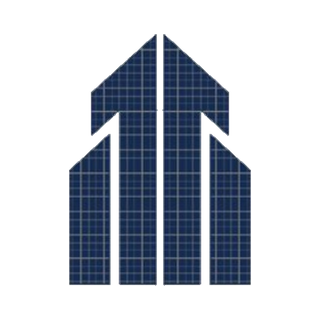

  

<h1 align="center">BIM Muhandis MCP</h1>

  <b>AI (Claude, ChatGPT, Gemini, Copilot) ni Revit, AutoCAD, Navisworks, Tekla va LIRA-SAPR ga ulaydi</b> 
  AI connector (MCP server) for Revit · AutoCAD / Civil 3D · Navisworks · Tekla Structures · LIRA-SAPR · Dynamo

  
  

  
  
  
  
  
  

  ⭐ <b>Foydali bo'lgan bo'lsa — yuqoridagi «Star» tugmasini bosing.</b> Shu bilan BIM Muhandis MCP boshqa muhandislarga ham yetib boradi. 
  ⭐ Если было полезно — нажмите «Star» вверху страницы. Так о BIM Muhandis MCP узнают и другие инженеры.

  <a href="https://t.me/bim_muhandis1">💠 Telegram</a> ·
  <a href="https://youtube.com/@bimmuhandis1">▶️ YouTube</a>

| Imkoniyat | |
|---|:-:|
| Revit 2022–2027 — modellashtirish, armatura, rasmiylashtirish (340+ tool) | ✅ |
| AutoCAD / Civil 3D 2022–2027 | ✅ |
| Navisworks — to'qnashuvlar (clash) qizil rangda | ✅ |
| Tekla Structures — temir-beton va metall | ✅ |
| LIRA-SAPR → Revit: armaturani solishtirish | ✅ |
| Dynamo — graf yaratish va ishga tushirish | ✅ |
| AI o'zi C# kod yozadi, yaxshisini yangi tool qilib saqlaydi | ✅ |
| Har amal — bitta Ctrl+Z, xatoda avtomatik bekor | ✅ |
| Claude Desktop, Claude Code, ChatGPT, Gemini, VS Code — bir vaqtda | ✅ |
| Avtomatik yangilanish — hech qanday oynasiz | ✅ |
| O'zbek · Русский · English | ✅ |

**O'rnatish:** `BimMuhandisMCP-Setup-1.6.11.exe` ni oching → AI ilovalar o'zi ulanadi → Revit'ni qayta oching.  
ZIP — o'rnatuvchisiz dastur fayllari (oflayn yoki qo'lda nusxalash uchun). Oddiy o'rnatish uchun Setup.exe tavsiya etiladi.

## Oxirgi versiya — 1.6.11 (10.11.2026)

BIM Muhandis MCP — AI ilovalar (Claude Desktop/Code, ChatGPT desktop, VS Code + Copilot, Gemini CLI, Antigravity, Cursor) uchun Revit, AutoCAD / Civil 3D, Navisworks, Tekla Structures va LIRA-SAPR 2022–2027 ulagichi.

O'rnatgach Launcher ochiladi: «AI ilovalar» bo'limida kerakli ilovani «Ulash» bosing va uni qayta oching.

- «Biz haqimizda» bo'limida yuklab olishlar va ⭐ yulduzchalar soni hamda «GitHub'da yulduzcha bosish» tugmasi
- bir martalik eslatma: MCP 3 kun ishlatilgach «Holat» sahifasida «⭐ foydali bo'lsa — yulduzcha bosing» (yopilgach qayta chiqmaydi)
- GitHub sahifasida doim faqat oxirgi versiya: to'g'ridan-to'g'ri «ZIP» va «Setup» yuklash tugmalari, oldingi versiyalar yashirin saqlanadi
- fonda ochilgan hujjat (uzel/shablon fayllari) MCP'ning faol hujjatiga aralashmaydi — noto'g'ri «TARGET_CHANGED» ogohlantirishi chiqmaydi

© BIM Muhandis jamoasi — Keldiyor Shokir Toshtemirov, Shohruh O'tkir O'rozov
